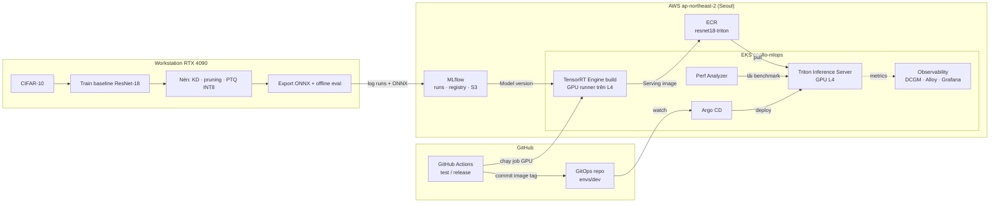

# Apollo — Deep Learning Model Compression & Triton Inference Serving

Dự án AIO-MLOps 2026. Câu hỏi trọng tâm:

> Mô hình nhỏ hơn hoặc chạy ở precision thấp hơn có **thực sự** tăng throughput, giảm latency và giảm GPU memory khi được phục vụ qua **Triton** hay không?

Nhóm train baseline **ResNet-18 trên CIFAR-10**, nén bằng **knowledge distillation**, **structured pruning** và **PTQ INT8**, build **TensorRT** (FP32/FP16/INT8), phục vụ qua **Triton** trên GPU **NVIDIA L4** (AWS EKS), rồi benchmark trong điều kiện so sánh công bằng.

## Kiến trúc



> Sơ đồ gốc (bản vẽ của nhóm) vẫn ghi region `ap-southeast-1`. Hạ tầng thực tế chạy ở **`ap-northeast-2` (Seoul)**, vì Singapore không có GPU L4 và Sydney hết hàng L4 (xem [`infra/terraform/README.md`](infra/terraform/README.md)).

## Thành viên và phần việc

| Thành viên | Vai trò | Phần chính trong repo |
| --- | --- | --- |
| **Tuấn** | PM + MLOps Engineer: Integration & Release | `infra/`, `.github/`, tích hợp, release |
| **Hoàng** | MLOps Engineer: Data & Training Pipeline | `src/baseline/`, `configs/` (training) |
| **Mạnh** | MLOps Engineer: Optimization Pipeline | `src/compression/`, script build TensorRT Engine |
| **Nam** | MLOps Engineer: Serving & Performance | `src/serving/`, `triton_models/`, `benchmarks/` |

## Cấu trúc repo (DEL-01)

```
AIO-MLOPS-Apollo/
├── src/                 # code Python
│   ├── baseline/        #   data pipeline, train/eval/export baseline (Hoàng)
│   ├── compression/     #   distillation, pruning, PTQ INT8 (Mạnh)
│   └── serving/         #   Triton, Smoke test, benchmark (Nam, ghép từ repo aio-mlops-serving)
├── configs/             # cấu hình YAML: training, compression, serving
├── scripts/             # lệnh chạy: train, export, build Engine, benchmark…
├── triton_models/       # Triton model repository: sinh ra khi chạy, không commit
├── benchmarks/          # bộ kết quả benchmark CHÍNH THỨC đã chốt cho report (DEL-04)
├── results/             # kết quả sinh ra khi chạy: không commit
├── docs/                # charter, kiến trúc, quyết định, report và slide
├── infra/               # hạ tầng AWS bằng Terraform + script vận hành (Tuấn)
└── .github/             # CI, mẫu PR
```

Mỗi thư mục có `README.md` ngắn mô tả phải đặt gì vào đó.

## Trạng thái (cập nhật 11/11/2026)

| Thành phần | Trạng thái | Phụ trách |
| --- | --- | --- |
| Dataset split + baseline ResNet-18 (**94.85%** top-1), ONNX đã kiểm tra | ✅ Xong. Code chưa vào repo này | Hoàng |
| Teacher ResNet-50, distillation, pruning, PTQ INT8 | ⏳ Chưa có kết quả | Mạnh |
| Hạ tầng AWS: EKS, GPU L4, ECR, S3, budget | ✅ Đang chạy ([`infra/terraform`](infra/terraform/README.md)) | Tuấn |
| MLflow (Postgres + S3), GitOps + Argo CD, HTTPS có đăng nhập | ✅ Đang chạy | Tuấn |
| GPU tự scale từ 0 (Cluster Autoscaler) | 🔄 Đang làm | Tuấn |
| GPU runner (ARC) + GitHub Actions release | ⏳ Chờ GitHub App | Tuấn |
| Triton + Smoke test + Benchmark matrix | ✅ Chạy trên CPU · ⏳ GPU chưa chạy thật ([aio-mlops-serving](https://github.com/dauvannam1804/aio-mlops-serving)) | Nam |
| Observability: DCGM, Alloy, Mimir/Loki/Tempo, Grafana | ⏳ | Nam |
| Model Portal (chọn version, kích hoạt release) | ⏳ Chưa giao | Chưa có |

Tiến độ chi tiết theo task: Google Sheet `AIO-MLOPS2026` của nhóm.

| Sprint | Thời gian | Mục tiêu |
| --- | --- | --- |
| 1 | 20–26/10 | Baseline end-to-end; thống nhất dữ liệu, cách đánh giá, môi trường |
| 2 | 27/10–02/11 | TensorRT FP32/FP16/INT8; prototype các kỹ thuật nén |
| 3 | 03–09/11 | Hoàn thiện distillation, pruning; tích hợp serving |
| 4 | 10–16/11 | Benchmark chính thức, tổng hợp và phân tích |
| 5 | 17–23/11 | Kiểm tra chạy lại; hoàn thiện report, slide; bàn giao |

## Dịch vụ dùng chung

| Dịch vụ | Link | Ghi chú |
| --- | --- | --- |
| MLflow | https://mlflow.3-39-32-158.sslip.io | Mỗi người một tài khoản (hỏi Tuấn). Artifact lưu S3, upload qua MLflow |
| Argo CD | https://argocd.3-39-32-158.sslip.io | Xem trạng thái deploy |
| GitOps repo | https://github.com/YouttyLe-DSAI/AIO-MLOPS-Apollo-gitops | Private. Cấu hình deploy cho Argo CD |
| Repo serving | https://github.com/dauvannam1804/aio-mlops-serving | Private. Sẽ ghép vào `src/serving/` |

Log một run lên MLflow từ máy training:

```bash
export MLFLOW_TRACKING_URI=https://mlflow.3-39-32-158.sslip.io
export MLFLOW_TRACKING_USERNAME=<tên>        # tuan | hoang | manh | nam
export MLFLOW_TRACKING_PASSWORD=<mật khẩu>   # nhận riêng từ Tuấn, KHÔNG commit
```

```python
import mlflow

mlflow.set_experiment("baseline")
with mlflow.start_run(run_name="resnet18-seed42"):
    mlflow.log_params({"epochs": 100, "lr": 0.1, "batch_size": 128})
    mlflow.log_metric("test_top1", 0.9485)
    mlflow.log_artifact("model.onnx")   # file lớn đi qua MLflow lên S3, không vào Git
```

## Đóng góp

Quy trình branch, PR, review và các quy tắc của repo (**repo đang public**: không commit mật khẩu hay file lớn): xem [`CONTRIBUTING.md`](CONTRIBUTING.md).
