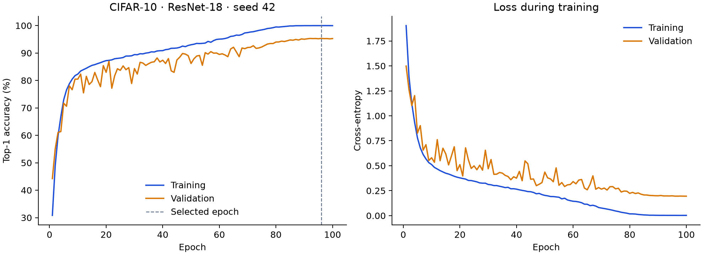
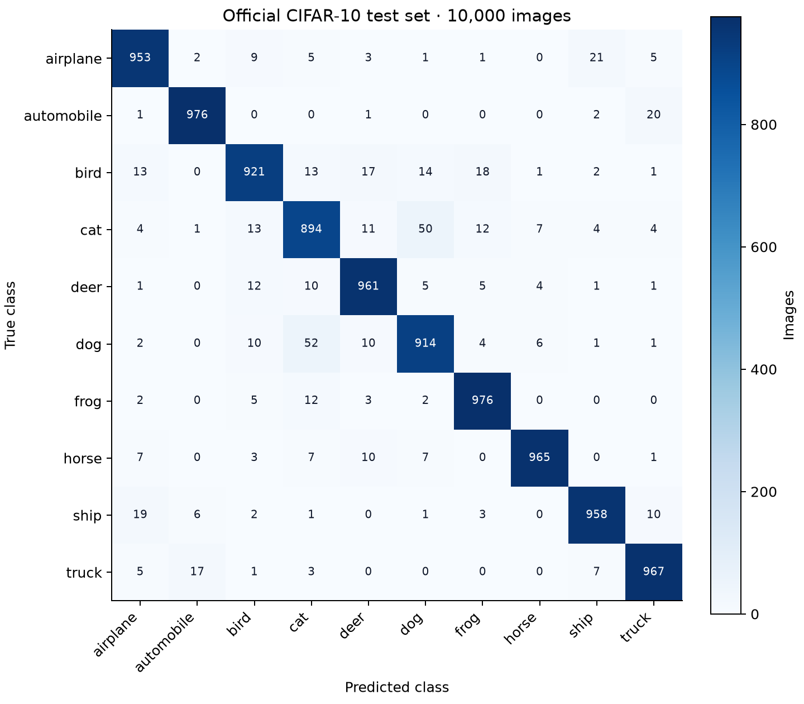

# Baseline training — ResNet-18 / CIFAR-10

## Kết quả thực chạy

Baseline train từ đầu đủ **100 epochs**, seed **42**, FP32 trên **NVIDIA H100 80GB HBM3**, server Brev `zalo-ai`. Chọn checkpoint theo validation, sau đó đánh giá một lần trên official test set. Không đặt ngưỡng accuracy từ tài liệu vì nguồn chưa quy định ngưỡng nghiệm thu.

| Chỉ số | Kết quả |
|---|---:|
| Validation top-1 tốt nhất | 95.32% |
| Epoch được chọn | 96 |
| PyTorch test top-1 (10.000 ảnh) | 94.85% |
| ONNX Runtime test top-1 (10.000 ảnh) | 94.85% |
| Test cross-entropy | 0.19925 |
| Số tham số | 11,173,962 |
| ONNX size | 42.62 MiB |
| Training + test evaluation | 23.68 phút |
| Peak PyTorch allocated VRAM | 1.09 GiB |

VRAM ở đây là peak bộ nhớ PyTorch cấp phát trong training/evaluation, không phải GPU memory khi serving và không bao gồm mọi vùng nhớ driver. Training time không gồm cài môi trường, tải dataset và export ONNX. Chưa đo latency/throughput/Triton serving.

## Data và phương pháp

- Dataset: official CIFAR-10, archive MD5 `c58f30108f718f92721af3b95e74349a`. Bản chạy dùng mirror Paddle vì nguồn Toronto tải chậm; checksum khớp archive chính thức. Tham khảo [mã dataset Paddle](https://github.com/PaddlePaddle/Paddle/blob/develop/python/paddle/dataset/cifar.py).
- Stratified split cố định: 45.000 train, 5.000 validation (500/class), 10.000 official test. Indices đầy đủ và SHA-256 từng file ở `results/baseline/dataset_manifest.json`.
- Calibration: 1.000 ảnh (100/class) lấy từ train; không giao validation/test. Dữ liệu này chỉ được đóng gói cho bước INT8 về sau, chưa chạy quantization.
- Augmentation chỉ train: RandomCrop(32, padding=4), RandomHorizontalFlip. Eval/calibration: tensor RGB /255, normalize mean `[0.4914,0.4822,0.4465]`, std `[0.2470,0.2435,0.2616]`.
- ResNet-18 CIFAR stem: conv 3×3 stride 1, bỏ maxpool, 10 classes; không pretrained ImageNet. API gốc: [torchvision ResNet-18](https://docs.pytorch.org/vision/2.0/models/generated/torchvision.models.resnet18.html).
- SGD lr 0.1, momentum 0.9, weight decay 0.0005; cosine schedule 100 epochs, batch 128. FP32, TF32 tắt, deterministic algorithms. Cấu hình đầy đủ đi kèm.
- Chọn best validation top-1, giữ checkpoint xuất hiện sớm hơn khi bằng điểm. Test không tham gia chọn checkpoint/hyperparameters.

## Kiểm chứng và truy vết

- 5 tests đạt: stratified split/leakage, invalid split, normalization, input/output model, resume tương đương chạy liên tục. Test resume dùng mô hình nhỏ và dữ liệu tổng hợp để kiểm tra optimizer/scheduler restart, không phải thí nghiệm accuracy CIFAR-10 bổ sung.
- `pip check`: không có dependency hỏng. Có 2 cảnh báo deprecation từ MLflow/Pydantic; không làm thất bại tests.
- ONNX checker đạt, dynamic batch 1/8/31 đạt `allclose(rtol=1e-3, atol=1e-4)` với PyTorch. Max absolute logit error **0.00000381**. So sánh này dùng input tổng hợp để kiểm tra export, không thay cho đánh giá dataset.
- Đánh giá ONNX trên đủ official test set bằng CPUExecutionProvider; accuracy lệch **0.0000 điểm phần trăm** so với PyTorch GPU.
- MLflow run gốc: `c41f4beaebf947a6b73b785c8c340ced`, experiment `cifar10-baseline`. Tracking file store trên server: `/home/ubuntu/mlops-baseline/mlruns`; [MLflow tracking](https://www.mlflow.org/docs/latest/tracking/).
- Checkpoint SHA-256: `7af55a05e13cd14a12d302bf231f3264861eff01fad87a3f38cb1fdd4cf230fa`.
- ONNX SHA-256: `854ce13226af8a634431e70e87bad2226d09d78e07acb641b6d431288dc0900a`.
- Python 3.12.3; torch 2.5.1+cu124; torchvision 0.20.1+cu124; CUDA 12.4; cuDNN 90100. `requirements.lock.txt` giữ phiên bản dependency thực tế; `environment.json` giữ hashes mã nguồn lúc bắt đầu run.
- `training_source.zip` giữ đúng mã nguồn đã thực hiện run, kiểm tra được với hashes trong `environment.json`. Sau khi khởi chạy, mã bàn giao được bổ sung bảo vệ metadata khi nhập sai config resume và xử lý history khi gián đoạn checkpoint; công thức training, model, dữ liệu và hyperparameters giữ nguyên.

## Bàn giao và giới hạn

Mã chạy: `src/baseline/`, config: `configs/baseline.yaml`, hướng dẫn train/evaluate/resume/export ở docs/baseline-training.md. Checkpoint: `artifacts/resnet18_cifar10_seed42/best.pt` và `last.pt`. ONNX: `triton_models/resnet18_cifar10_fp32/1/model.onnx`; input FP32 NCHW `[N,3,32,32]` đã normalize, output `logits` `[N,10]`.

`calibration.npy` có 1.000 tensors đã normalize; `inference_examples.npz` có 8 test inputs/labels cho smoke test. Các file lớn được giữ riêng khỏi Git. Gói portable có danh sách SHA-256 và có thể nhập lại vào MLflow bằng `scripts/import_mlflow.py`.

Đây là baseline một seed trên H100, khác RTX 4090 trong sơ đồ. Chưa train ResNet-50 teacher, chưa thực hiện PTQ/KD/pruning, chưa build TensorRT, chưa kiểm tra Triton live, chưa đo serving benchmark. Dockerfile và GitHub Actions đã chuẩn bị nhưng chưa được build/chạy trên hệ thống CI. Cần reviewer nhóm xác nhận protocol và chất lượng baseline trước khi đánh dấu task Done trên bảng chung.

Nguồn yêu cầu: [Google Docs](https://docs.google.com/document/d/1ir1vsAyo6xA5cESlyBSUOfrEZFARnBPQK_E3PCPbjMQ/edit), [Google Sheets](https://docs.google.com/spreadsheets/d/1UKM-6IyY2Y1gE1NbCutgXKU2Jz_GQ6HfzXx88_HXRFg/edit?gid=315438118), hai sơ đồ đính kèm. Scope thực hiện theo yêu cầu trực tiếp chuẩn bị baseline training; nội dung AWS/GitOps và ví dụ khác trong tài liệu không được coi là lệnh triển khai.

## Cập nhật cấu hình mục tiêu RTX 4090 — 07/11/2026

`configs/baseline.yaml` hiện dùng train/eval batch 128/128, workers/threads 4/4, FP32 và ngân sách CUDA allocator 16 GiB cố định. Output mới: `artifacts/resnet18_cifar10_rtx4090_seed42/`. `results/baseline/config.yaml` giữ nguyên cấu hình run H100 100 epochs ở trên.

Kiểm tra ngắn 3 bước train + 1 batch validation trên **NVIDIA H100 80GB HBM3** đạt: peak allocated **0.94 GiB**, peak reserved **1.49 GiB**. Bộ 8 tests sau thay đổi đạt. Xem `results/rtx4090-profile/gpu-fit.json` và [ảnh demo](results-demo.md).

Giới hạn áp dụng cho caching allocator của PyTorch, không gồm toàn bộ CUDA/driver. Đây là kiểm tra tài nguyên với profile hướng tới 4090 trên H100; chưa chạy RTX 4090 thật và chưa train lại 100 epochs bằng profile mới. Kết quả 94,85% và thời gian 23,68 phút ở trên tiếp tục thuộc run H100 gốc.

## Bổ sung: serving benchmark đã hoàn tất

Báo cáo training/offline phía trên giữ nguyên dữ liệu của run gốc. Baseline FP32 hiện đã đăng ký thành `resnet18-cifar10` version 2, Release lên Triton/TensorRT trên L4 và hoàn tất benchmark. Smoke test đạt 94,85% trên 10.000 ảnh; 12/12 điểm, 36 lần đo, CV throughput lớn nhất 0,79%. Xem [báo cáo serving](baseline-serving-benchmark.md) và raw data để truy vết các số đo mới.
