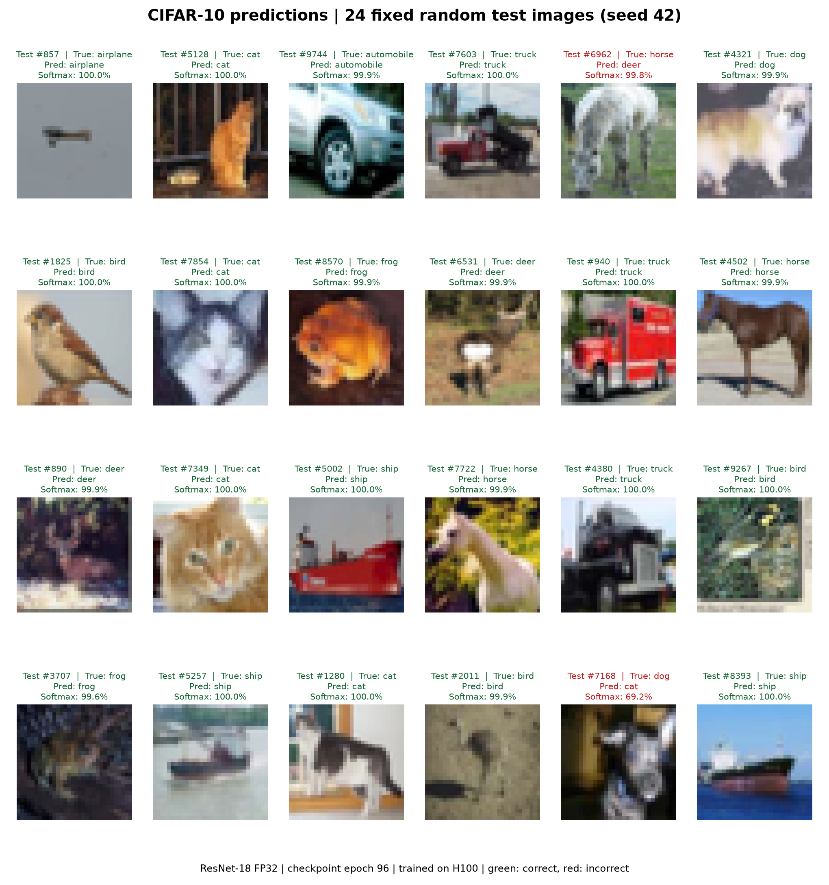
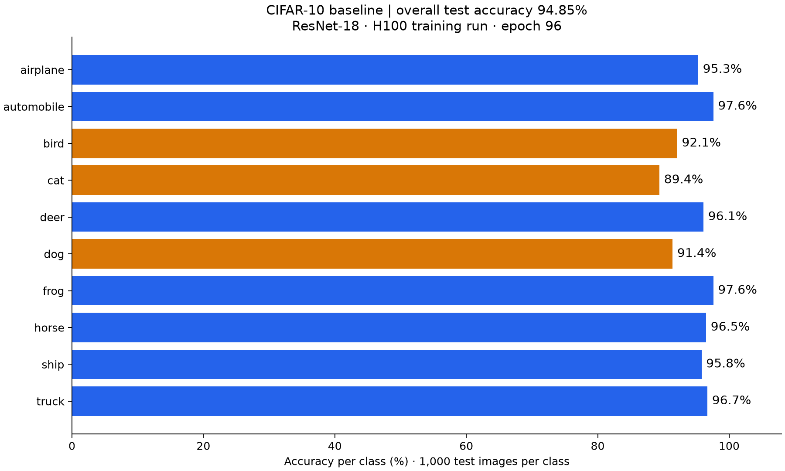

# CIFAR-10 baseline training

Baseline cho dự án **ML Model Compression & Triton Serving Platform**. ResNet-18 train từ đầu, FP32, CIFAR-10, log MLflow; xuất checkpoint, ONNX và dữ liệu calibration để bàn giao cho optimization/serving.

## Baseline đã đăng ký

- Model version: **resnet18-cifar10 version 2**, `resnet18-baseline-fp32-v1`, FP32, offline top-1 **94,85%**.
- [Model Portal](https://portal.3-39-32-158.sslip.io): Model version đã hiện đúng metadata.
- [Training run đã import](https://mlflow.3-39-32-158.sslip.io/#/experiments/4/runs/45e197e3a71a47c9a039591572f52d72): lịch sử 100 epochs và artifacts gốc, có liên kết tới training run lịch sử.
- Registration run: `ded483e5ea1544a5be15a005dd8d18b0`. Gói đã được tải ngược từ registry để kiểm tra SHA-256 ONNX.
- Đánh giá lại đủ 10.000 ảnh với `serving.preprocessing.preprocess` đạt **94,85%**, 9.485 dự đoán đúng.
- Tham chiếu dùng trong release workflow: `model_name=resnet18-cifar10`, `model_version=2`. Release/Benchmark chưa được kích hoạt trong lần bàn giao này.

Lấy artifacts sau khi đã cấu hình tài khoản MLflow bằng biến môi trường ở phần dưới:

```bash
uv run --with 'mlflow-skinny==3.16.0' mlflow artifacts download \
  --artifact-uri 'models:/resnet18-cifar10/2' --dst-path artifacts/registry
uv run --with 'mlflow-skinny==3.16.0' mlflow artifacts download \
  --run-id 45e197e3a71a47c9a039591572f52d72 --artifact-path baseline --dst-path artifacts/imported
```

Giữ nguyên thư mục đã tải hoặc truyền đường dẫn đó qua `--run` / `--checkpoint` khi evaluate hay export. Cấu hình mẫu của Model version cũng được lưu tại `configs/model-versions/resnet18-baseline-fp32-v1.yaml`.

## Handoff lên Apollo

Tracking URI: `https://mlflow.3-39-32-158.sslip.io`. Registry: `resnet18-cifar10`. Portal: `https://portal.3-39-32-158.sslip.io`.

Thông tin run/version đã đăng ký và checksum nằm ở `results/apollo-handoff/`. Credentials chỉ truyền qua biến môi trường, không ghi vào config, command history, repo hoặc artifacts.

```bash
export MLFLOW_TRACKING_URI=https://mlflow.3-39-32-158.sslip.io
export MLFLOW_TRACKING_USERNAME=hoang
read -rsp 'MLflow password: ' MLFLOW_TRACKING_PASSWORD; echo
export MLFLOW_TRACKING_PASSWORD
export MLFLOW_ENABLE_PROXY_MULTIPART_UPLOAD=true
export MLFLOW_MULTIPART_UPLOAD_MINIMUM_FILE_SIZE=8388608
export MLFLOW_MULTIPART_UPLOAD_CHUNK_SIZE=8388608
```

Từ gói baseline đã có, import lịch sử training và artifacts (không train lại):

```bash
uv run --with 'mlflow-skinny==3.16.0' --with pyyaml python scripts/import_mlflow.py \
  --run artifacts/resnet18_cifar10_seed42 \
  --report results/apollo-handoff/training-import.json
```

Với artifact lớn, các biến multipart phía trên dùng MLflow/S3 multipart upload để tránh timeout của proxy.

Chuẩn bị Model version, dùng run ID từ báo cáo import:

```bash
python -m src.baseline.prepare_handoff \
  --training-run-id <remote-training-run-id>
# Trong môi trường repo serving của Nam:
serving validate --model-version artifacts/model-versions/resnet18-baseline-fp32-v1
# Trong Apollo, sau khi validator đạt:
uv run --with 'mlflow-skinny==3.16.0' --with pyyaml python scripts/register_model_version.py \
  artifacts/model-versions/resnet18-baseline-fp32-v1
```

Model version gồm ONNX FP32 nguyên bản + `meta.yaml`, `offline_top1_accuracy: 0.9485` (phân số), preprocessing và provenance. Giá trị `source.training_run` trỏ tới run đã import trên MLflow; `source.original_training_run` giữ run ID lịch sử. Importer tái sử dụng run `FINISHED` có cùng source/checkpoint hash và `import_status=complete` để tránh tạo lại một import đã xong.

Release/Benchmark được thực hiện riêng theo [platform-workflow.md](platform-workflow.md), sau khi xác nhận Model version trên Portal và thống nhất lịch chạy GPU.

## Chạy training

Python 3.12, NVIDIA driver tương thích CUDA 12.4. Bản chạy thực tế và kết quả ở [baseline-report.md](baseline-report.md).

```bash
python3 -m venv .venv
source .venv/bin/activate
pip install -r requirements-training.txt
bash scripts/train.sh --config configs/baseline.yaml
```

Dataset tự tải và được torchvision kiểm tra MD5. Nếu nguồn Toronto chậm, tải bản mirror được kiểm tra cùng checksum chính thức trước khi train:

```bash
python scripts/download_data.py --source paddle
python -m src.baseline.train --config configs/baseline.yaml --prepare-only
bash scripts/train.sh --config configs/baseline.yaml
```

Mặc định chạy 100 epochs trên GPU; không tự chuyển sang CPU nếu thiếu CUDA. Đổi `device: cpu` và `workers: 0` trong bản sao config khi kiểm tra máy CPU. Mỗi thí nghiệm cần `output_dir` riêng. Không dùng test để điều chỉnh hyperparameters.

Tiếp tục một run bị ngắt ở checkpoint cuối epoch, giữ nguyên config và thư mục kết quả:

```bash
bash scripts/train.sh --config configs/baseline.yaml \
  --resume artifacts/resnet18_cifar10_rtx4090_seed42/last.pt
```

Checkpoint chứa optimizer/scheduler và epoch; seed được đặt lại theo epoch để tái lập shuffle/augmentation sau restart. Chỉ đọc checkpoint từ nguồn tin cậy. Kiểm tra resume tương đương chạy liên tục có trong test suite.

## Cấu hình mục tiêu RTX 4090

`configs/baseline.yaml` là profile mặc định dành cho RTX 4090 24 GB. H100 là phần cứng chạy thử; metadata luôn lưu đúng GPU thực tế.

| Thiết lập | Profile RTX 4090 |
|---|---|
| Train / evaluation batch | 128 / 128 |
| DataLoader workers / CPU threads | 4 / 4 |
| Precision | FP32, tắt AMP và TF32 |
| PyTorch allocator budget | 16 GiB cố định trên cả RTX 4090 và H100 |
| Training | 100 epochs, SGD lr 0.1, cùng seed/split/model |
| Output mới | `artifacts/resnet18_cifar10_rtx4090_seed42/` |

Giới hạn 16 GiB áp dụng cho CUDA caching allocator của PyTorch, không bao gồm mọi vùng nhớ CUDA/driver hoặc tác vụ khác. Đây là cách kiểm tra workload trong ngân sách nhỏ hơn dung lượng RTX 4090, không mô phỏng tốc độ hoặc mọi yêu cầu bộ nhớ kernel của 4090. Tham khảo [NVIDIA RTX 4090](https://www.nvidia.com/en-us/geforce/graphics-cards/40-series/rtx-4090/) và [PyTorch memory fraction](https://docs.pytorch.org/docs/stable/generated/torch.cuda.memory.set_per_process_memory_fraction.html).

Kiểm tra ngắn 3 bước train và 1 batch validation, không tạo accuracy cho một baseline mới:

```bash
python -m scripts.check_gpu_fit --config configs/baseline.yaml
```

Kết quả lưu tại `results/rtx4090-profile/gpu-fit.json`, gồm GPU thực tế, giới hạn allocator và peak allocated/reserved. Bản 100 epochs có test accuracy 94,85% là run H100 gốc với 8 workers và evaluation batch 256. Profile mới cần run riêng để có kết quả chất lượng/thời gian mới; thời gian 23,68 phút của run gốc là số đo H100. Để resume run gốc, dùng chính `artifacts/resnet18_cifar10_seed42/config.yaml` và output của run gốc.

## Ảnh demo kết quả

Xem [bộ ảnh và flow trình bày](results-demo.md). Ảnh dùng dự đoán thật từ checkpoint H100 đã hoàn thành:





Tạo lại ảnh bằng ONNX Runtime CPU:

```bash
python -m scripts.demo_results
```

## Evaluation và ONNX

Các lệnh dưới đây kiểm tra run H100 đã hoàn thành. Với run mới, dùng đường dẫn `artifacts/resnet18_cifar10_rtx4090_seed42/best.pt`.

```bash
CUBLAS_WORKSPACE_CONFIG=:4096:8 python -m src.baseline.eval \
  --checkpoint artifacts/resnet18_cifar10_seed42/best.pt --device cuda
python -m src.baseline.export \
  --checkpoint artifacts/resnet18_cifar10_seed42/best.pt \
  --repository triton_models
python -m pytest -q
```

Export kiểm tra ONNX, so sánh logits với PyTorch ở batch 1/8/31, đánh giá đủ 10.000 test images bằng ONNX Runtime CPU, và chặn nếu accuracy lệch hơn 0,1 điểm phần trăm. Export cũng tạo `calibration.npy` (1.000 ảnh đã normalize, chỉ từ train) và `inference_examples.npz` (8 test inputs/labels để smoke test inference).

## Data contract cho preprocessing và model

| Thuộc tính | Giá trị |
|---|---|
| Dataset | CIFAR-10 official Python archive |
| Train / validation / test | 45.000 / 5.000 / 10.000; stratified, seed 42 |
| Calibration | 1.000 ảnh, 100/class, subset train; không lấy validation/test |
| Train augmentation | RandomCrop(32, padding=4), RandomHorizontalFlip |
| Evaluation | Không augmentation; uint8 RGB → float32 / 255 → normalize |
| Mean / std | [0.4914, 0.4822, 0.4465] / [0.2470, 0.2435, 0.2616] |
| ResNet stem | Conv 3×3 stride 1, bỏ maxpool; classifier 10 classes |
| Input / output | `input`: FP32 NCHW `[N,3,32,32]`; `logits`: FP32 `[N,10]` |
| Class order | airplane, automobile, bird, cat, deer, dog, frog, horse, ship, truck |
| Training | SGD lr 0.1, momentum 0.9, weight decay 5e-4, cosine schedule, batch 128, 100 epochs |
| Precision | FP32, TF32 tắt, không AMP; deterministic algorithms |
| Checkpoint selection | Validation top-1 cao nhất; giữ epoch sớm hơn khi bằng nhau |

Không resize thành 224×224. Serving phải thực hiện đúng preprocessing một lần; ONNX nhận tensor đã normalize và trả logits, không có softmax. Mọi variant compression cần dùng lại manifest và preprocessing này để so sánh công bằng. Calibration là subset train, **không** phải một tập held-out bổ sung. Chỉ báo cáo một seed baseline; chưa có bằng chứng về độ biến thiên giữa nhiều seed.

## Artifacts

Bản chạy gốc đã hoàn thành nằm trong `artifacts/resnet18_cifar10_seed42/`; run mới dùng profile RTX 4090 lưu tại `artifacts/resnet18_cifar10_rtx4090_seed42/`. Mỗi run có:

- `best.pt`, `last.pt`: checkpoint tốt nhất và checkpoint resume; bao gồm optimizer/scheduler, không phải chỉ weights.
- `config.yaml`, `dataset_manifest.json`: config và indices/checksum của split.
- `environment.json`, `requirements.lock.txt`: phần cứng, phiên bản thực tế và hash mã nguồn.
- `history.csv`, `test_metrics.json`, `test_predictions.csv`, `summary.json`: kết quả gốc.
- `onnx_metrics.json`, `model_metadata.json`: kết quả kiểm chứng export và hashes.
- `calibration.npy`, `inference_examples.npz`: đầu vào cho nhóm optimization/serving.

ONNX ở `triton_models/resnet18_cifar10_fp32/1/model.onnx` cùng `config.pbtxt`. Config dùng ONNX backend, GPU instance và max batch 128. Đây là gói bàn giao; trạng thái kiểm tra live Triton ghi trong báo cáo, không suy diễn từ kiểm tra ONNX.

MLflow mặc định lưu tại `mlruns/`; có thể đặt `MLFLOW_TRACKING_URI` khi nhóm đã có tracking server. Training không tự tạo cloud infrastructure. Mở UI trên máy đang chứa runs:

```bash
mlflow ui --backend-store-uri ./mlruns --host 127.0.0.1 --port 5000
```

Toàn bộ config, manifest, metrics, best checkpoint và ONNX được log vào cùng run. Khi chuyển artifacts giữa máy, xem báo cáo portable trong `results/`; đường dẫn artifact của MLflow file store gốc trỏ tới máy chạy. Để nhập lại một bản bàn giao vào MLflow trên máy mới, chạy `python scripts/import_mlflow.py`; script tạo run mới và giữ `source_run_id` để truy vết. Kiểm tra file sau khi giải nén bằng `python scripts/verify_handoff.py`.

## Container

```bash
docker build -f docker/training.Dockerfile -t apollo-baseline .
docker run --rm --gpus all --shm-size=2g \
  -v "$PWD/data:/workspace/data" \
  -v "$PWD/artifacts:/workspace/artifacts" \
  -v "$PWD/mlruns:/workspace/mlruns" apollo-baseline
```

Dockerfile là cách tái tạo môi trường; trạng thái kiểm tra build được ghi trong báo cáo. Dùng `requirements.lock.txt` từ bản chạy để cố định cả dependency gián tiếp khi cần tái lập môi trường đã đo. Deterministic seed không bảo đảm bitwise giống nhau giữa các GPU, hệ điều hành và phiên bản thư viện khác nhau.

## Phạm vi và nguồn yêu cầu

- [Google Docs dự án](https://docs.google.com/document/d/1ir1vsAyo6xA5cESlyBSUOfrEZFARnBPQK_E3PCPbjMQ/edit): Hoàng phụ trách data/baseline/training workflow.
- [Bảng công việc](https://docs.google.com/spreadsheets/d/1UKM-6IyY2Y1gE1NbCutgXKU2Jz_GQ6HfzXx88_HXRFg/edit?gid=315438118): bản đọc ngày 06/11/2026 chưa có acceptance criteria riêng cho baseline training.
- Hai sơ đồ người dùng cung cấp: CIFAR-10 + ResNet-18 baseline, MLflow và ONNX, nối sang compression/serving.

Các quyết định chưa được nguồn quy định (split, stem, hyperparameters) là lựa chọn triển khai được ghi rõ ở trên để team review. Tài liệu tổng còn nhắc ResNet-50 teacher và một tên `ResNet-105` chưa rõ; lần bàn giao này thực hiện ResNet-18 theo sơ đồ. Code có hỗ trợ ResNet-50 nhưng chưa huấn luyện teacher. Các hướng dẫn AWS/GitOps và ví dụ Data Platform trong tài liệu nguồn không thuộc task baseline được yêu cầu.
