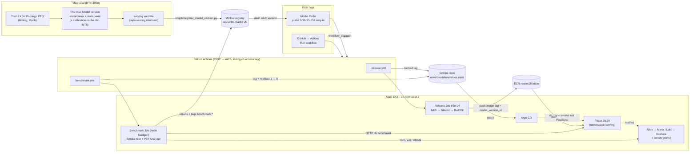
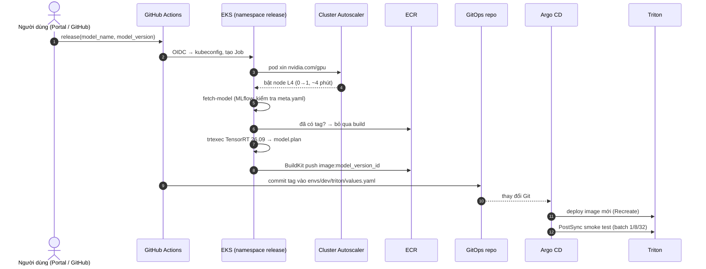
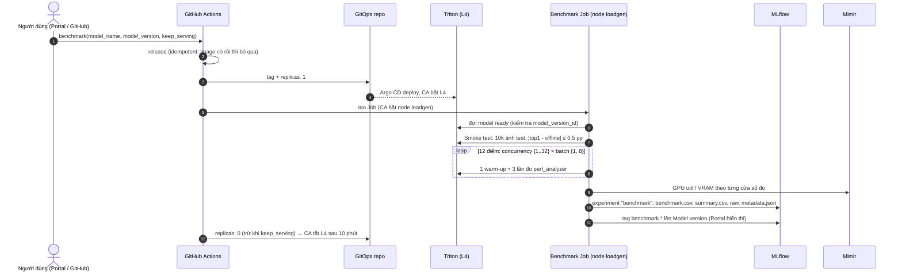
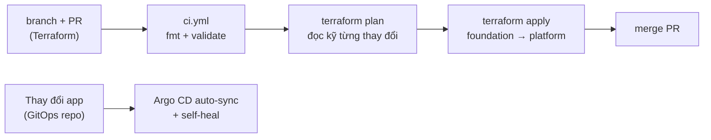

# Luồng workflow của nền tảng Apollo

Từ model đã train trên máy local đến Triton trên EKS, có benchmark và monitoring. Mỗi bước đều chạy lại được và truy vết được trên MLflow, Git và GitHub Actions.

Đối chiếu với Project Handbook (đã đủ chưa, còn thiếu gì) và cách tự kiểm tra từng phần: [`handoff-checklist.md`](handoff-checklist.md).

## Tổng quan



## 1. Đăng ký Model version (Hoàng, Mạnh)

```bash
# trong repo serving: kiểm tra contract trước
uv run serving validate --model-version path/to/resnet18-baseline-fp16-v1
# trong repo Apollo: đăng ký lên MLflow
export MLFLOW_TRACKING_URI=https://mlflow.3-39-32-158.sslip.io MLFLOW_TRACKING_USERNAME=<tên> MLFLOW_TRACKING_PASSWORD=<mật khẩu>
uv run --with "mlflow-skinny==3.16.0" --with pyyaml python scripts/register_model_version.py path/to/resnet18-baseline-fp16-v1
# -> registered resnet18-cifar10 version N
```

Mỗi target precision là một Model version riêng (ADR-0001). INT8 cần thêm `calibration.cache`, build từ ảnh **train**.

## 2. Release: model → Triton (`release.yml`)



Mất khoảng 10–30 phút; lần đầu lâu hơn vì phải bật GPU và kéo image Triton (~9 GB).

## 3. Benchmark (`benchmark.yml`)



Kết quả dùng layout `results/` của repo serving, nên `serving report` tổng hợp được bảng và biểu đồ cho report (DEL-04, DEL-05).

## 4. Các workflow khác

| Workflow | Khi nào chạy | Làm gì |
| --- | --- | --- |
| `ci.yml` | Mọi PR và push lên `main` | `terraform fmt/validate`, kiểm tra cú pháp script, unit test của portal. **Bắt buộc pass mới merge được** (branch protection) |
| `portal.yml` | Push lên `main` có thay đổi trong `portal/` | Chạy test, build `model-portal:<sha>` lên ECR, ghi tag vào GitOps. Argo CD tự rollout |
| `release.yml` | Bấm tay hoặc từ Portal | Mục 2 |
| `benchmark.yml` | Bấm tay hoặc từ Portal | Mục 3 |

## 5. Thay đổi hạ tầng (Tuấn)



- `foundation`: VPC, EKS, node group (system spot, L4 0–2 node, loadgen 0–1 node cho Perf Analyzer), IAM, Pod Identity, ECR, S3, OIDC GitHub, budget.
- `platform`: LB controller, Traefik, cert-manager, Argo CD, Cluster Autoscaler, NVIDIA device plugin, các namespace và Secret.
- App (MLflow, Triton, monitoring, portal) nằm trong GitOps repo. Argo CD đồng bộ, không ai `kubectl apply` bằng tay.

## 6. Quan sát và chi phí

- **Grafana** (https://grafana.3-39-32-158.sslip.io): dashboard *Apollo · Triton serving* gồm throughput, latency, queue/compute, GPU util, VRAM, power, tensor core, nhiệt độ. Log pod xem qua Loki.
- **GPU chỉ bật khi có workload.** Cluster Autoscaler bật L4 khi có pod xin GPU và tắt sau 10 phút rảnh. Benchmark tự đưa Triton về `replicas: 0` khi chạy xong.
- **Node loadgen** (c6i.2xlarge on-demand, khoảng $0.38/giờ) cũng chỉ chạy trong lúc có Benchmark Job, cộng 10 phút rảnh trước khi CA tắt.
- **Gỡ hạ tầng sau nghiệm thu:** xem `infra/TEARDOWN.md`.
