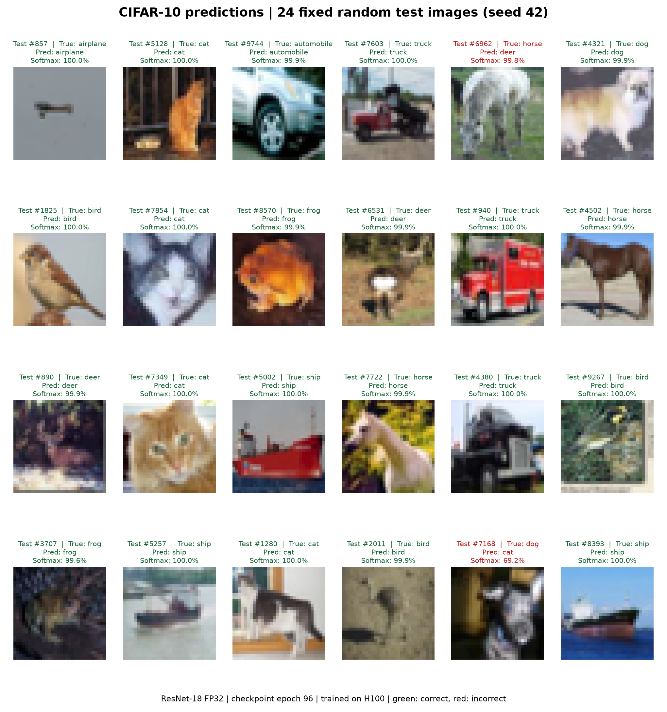
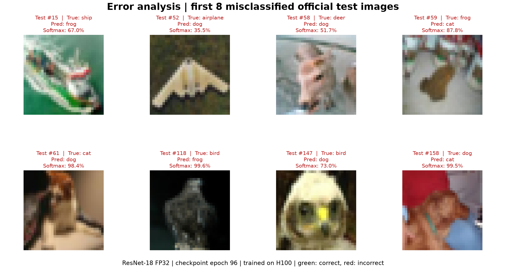
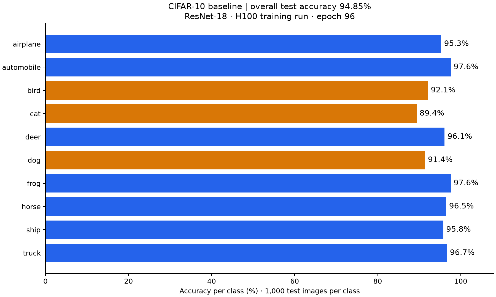
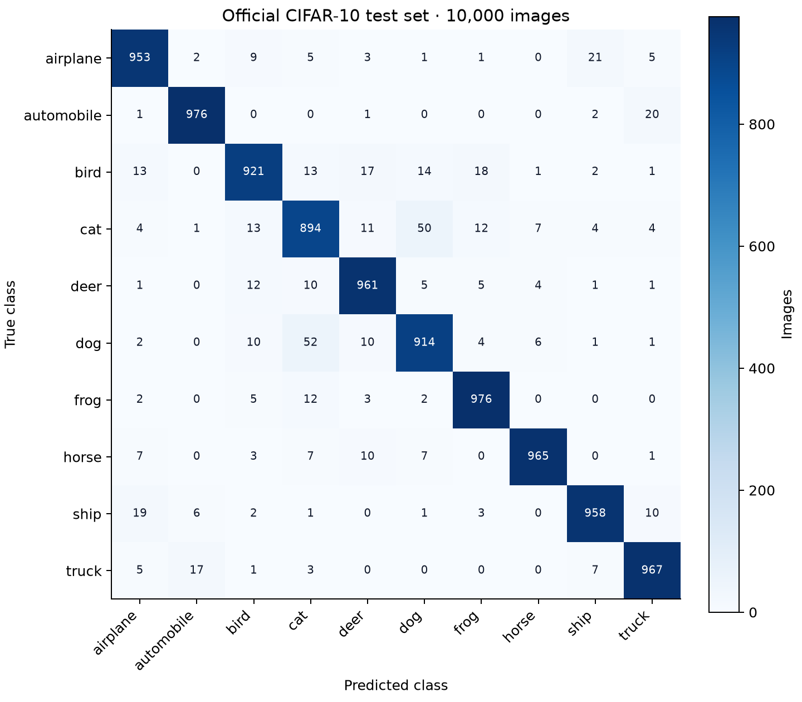
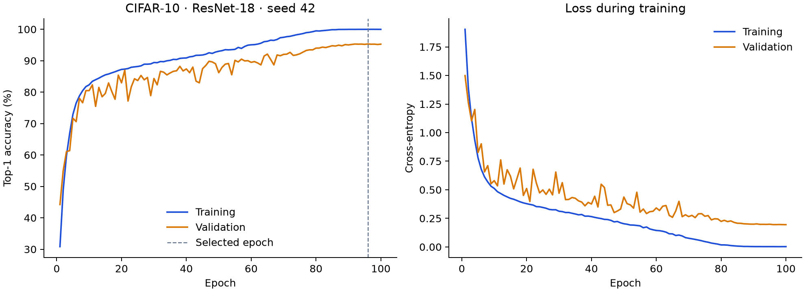

# Ảnh demo và flow trình bày baseline

Các ảnh dưới đây dùng dữ liệu CIFAR-10 thật và checkpoint ResNet-18 **epoch 96**, được train trên **H100**. Kết quả toàn bộ test set: **94,85%**, validation tốt nhất: **95,32%**. Cấu hình mục tiêu RTX 4090 mới được kiểm tra ngắn về tài nguyên trên H100; chưa có số đo trên RTX 4090 thật.

## 1. Mô hình dự đoán ra sao?

24 ảnh test được chọn ngẫu nhiên với seed 42, cố định giữa các lần tạo demo. Mỗi ảnh ghi nhãn thật, nhãn dự đoán và giá trị softmax của dự đoán. Màu xanh là đúng, đỏ là sai. Accuracy 94,85% được tính trên toàn bộ 10.000 ảnh test, không phải trên gallery này.

## 2. Những trường hợp nào còn sai?

8 trường hợp sai đầu tiên theo thứ tự official test set. Đây là ảnh phục vụ phân tích lỗi, không phải mẫu ngẫu nhiên để ước lượng accuracy.

## 3. Kết quả từng lớp

Mỗi lớp có 1.000 ảnh test. Dùng biểu đồ này để giải thích khác biệt giữa các lớp và đối chiếu confusion matrix.

## 4. Quá trình học

Biểu đồ training/validation qua 100 epochs; đường dọc đánh dấu checkpoint epoch 96 được chọn theo validation. Test set không tham gia chọn checkpoint.

## 5. Trình bày cấu hình 4090

| Thành phần | Cấu hình mục tiêu |
|---|---|
| GPU mục tiêu | NVIDIA GeForce RTX 4090, 24 GB |
| Máy chạy thử hiện tại | H100 80 GB của `zalo-ai` |
| Train / validation batch | 128 / 128 |
| Workers / CPU threads | 4 / 4 |
| Precision | FP32; AMP và TF32 tắt |
| Ngân sách CUDA allocator | 16 GiB cố định, áp dụng cả trên H100 |
| Quy trình học | Cùng ResNet-18, split, seed, SGD và 100 epochs |

Kiểm tra 3 bước train + 1 batch validation trên H100: **đạt**, peak allocated khoảng **0,94 GiB**, peak reserved khoảng **1,49 GiB**. Các số này chỉ đo bộ nhớ PyTorch trong kiểm tra ngắn; không phải thời gian hoặc phép đo trên RTX 4090. Metadata chi tiết ở [gpu-fit.json](../results/rtx4090-profile/gpu-fit.json).

Thứ tự thuyết trình gợi ý: **flow dữ liệu → cấu hình 4090 → training curves → ảnh dự đoán → ảnh lỗi → kết quả từng lớp → ONNX và bàn giao**.

Tạo lại ba ảnh demo mới bằng `python -m scripts.demo_results`; lựa chọn ảnh và dự đoán được lưu tại [demo-predictions.json](../results/baseline/demo-predictions.json). Các ảnh được render bằng Matplotlib, sử dụng ONNX Runtime CPU và dữ liệu gốc, không dùng ảnh minh họa sinh bằng AI.
