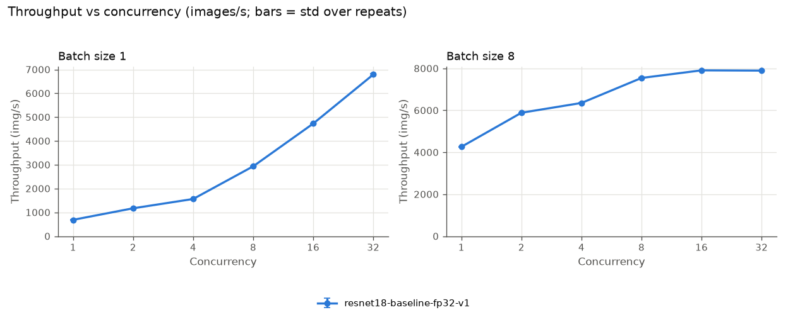
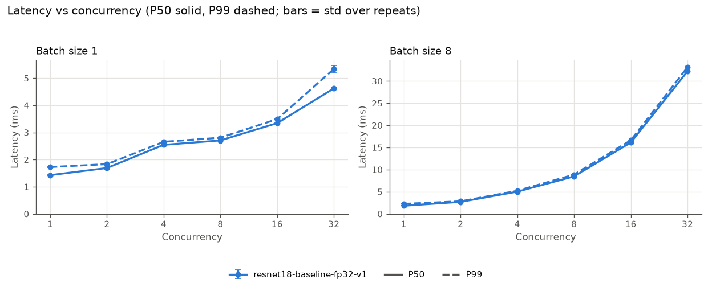

# Baseline FP32 — Release và Benchmark

Model version: **resnet18-cifar10 v2**, `resnet18-baseline-fp32-v1`.

- [GitHub Actions](https://github.com/YouttyLe-DSAI/AIO-MLOPS-Apollo/actions/runs/45157351610)
- [MLflow benchmark run](https://mlflow.3-39-32-158.sslip.io/#/experiments/3/runs/96bc50c90d1945ed921c30046014fef0)
- [Model Portal](https://portal.3-39-32-158.sslip.io)

## Kết quả

| Chỉ số | Kết quả |
|---|---:|
| GPU đo thực tế | NVIDIA L4 |
| Offline top-1 | 94.85% |
| Triton Smoke test top-1 | 94.85% trên 10,000 ảnh |
| Chênh lệch chất lượng | 0.0000 điểm phần trăm |
| Throughput cao nhất (mean 3 lần đo) | 7,907.6 ảnh/s tại concurrency 16, batch 8 |
| P95 tại concurrency 1, batch 1 (mean) | 1.6100 ms |
| Ma trận | 12/12 điểm, 1 warm-up + 3 lần đo mỗi điểm |
| CV throughput lớn nhất | 0.788% |
| Metadata | `completed` |

## Điều kiện đo và truy vết

Đây là số đo trên EKS L4, với TensorRT backend, strict FP32 (`--noTF32`), 1 GPU instance, dynamic batching và max batch size 32. Load generator chạy trên node riêng. Ma trận concurrency 1/2/4/8/16/32 × batch 1/8, cửa sổ Perf Analyzer 5 s, ổn định 10%, tối đa 10 trials.

`metadata.json`, `benchmark_config.yaml`, `smoke_test.json`, raw CSV/stdout của warm-up và mọi lần đo được giữ nguyên trong thư mục raw đã tải từ MLflow. `raw-files-sha256.json` lưu checksum; `verification.json` kiểm tra completeness và CV độc lập. Để dùng reader workstation của repo serving, phần cứng EKS được ánh xạ từ `hardware.gpu.modelName` sang `hardware.gpus[].name` chỉ trong bộ nhớ khi tạo report, không thay metadata gốc.

Bảng từng điểm gồm mean và sample standard deviation: [report/summary.md](report/summary.md), [report/summary.csv](report/summary.csv).
